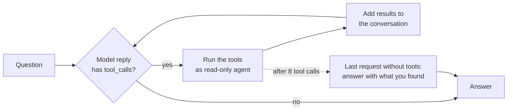

# K8s AIOps Agent

An assistant that explains problems in a Kubernetes cluster. Ask it a question in plain words, e.g. *"Why is the app in namespace aiops-lab not working?"*. It decides itself which read-only tools to call (`kubectl get / describe / logs`, events), reads the results and explains what is wrong and how to fix it.

- **Plain Python** – no LangChain or LlamaIndex; the whole agent loop is one short file, [`aiops/agent.py`](aiops/agent.py).
- **Local LLM** – `qwen3:4b-instruct` via [Ollama](https://ollama.com) with tool calling; nothing leaves the machine.
- **Read-only by design** – two layers: the code only offers fixed, checked tools, and the cluster gives the agent a ServiceAccount that can look but not change anything (and cannot read Secrets).

> **Status:** Phase 2 done – read-only tools, agent loop and `aiops` CLI work against a real cluster. Next: broken test scenarios and an eval to measure answer quality (Phase 3).

## Example

```text
$ aiops ask "Are all pods in namespace study-rag healthy?"
Investigating with qwen3:4b-instruct ...
  → get_resources(kind=pods, namespace=study-rag)  [583 chars]

**Problem:** ...
**Cause:** ...
**Evidence:** ...
**Fix:** ...

(1 tool calls, 10.2 s)
```

Every tool call is printed while the agent works (`-v` also prints the full tool output), then the answer in a fixed format: Problem, Cause, Evidence, Fix. The fix is a suggestion for you – the agent never runs it.

## How it works



1. **Tool menu** – the model gets the question, a system prompt and a list of tools as JSON Schema ([`registry.py`](aiops/tools/registry.py)). It picks tools from their *description* text alone.
2. **Tool call** – instead of text, the model replies with e.g. `get_logs(pod="api-55f4", namespace="study-rag", previous=true)`. The model can't run anything itself; the code does.
3. **Loop** – the result goes back into the conversation and the model is asked again, until it answers in text.
4. **Step limit** – after 8 tool calls, one last request is sent *without* tools, so a small model can't loop forever.

Errors from tools come back as text (`ERROR: pods "xyz" not found`) instead of exceptions: the model reads them and can correct itself.

### Tools

| Tool | Runs | Used for |
|---|---|---|
| `get_resources(kind, namespace?)` | `kubectl get <kind> -o wide` | Overview: status, READY, restarts |
| `describe(kind, name, namespace?)` | `kubectl describe` | Probes, limits, conditions, recent events (OOMKilled, ImagePullBackOff …) |
| `get_events(namespace?)` | `kubectl get events --sort-by=.lastTimestamp` | What happened, newest last |
| `get_logs(pod, namespace, container?, previous?, tail?)` | `kubectl logs` | `previous=true`: the log of the container that crashed |

### Read-only in two layers

| Layer | Where | What it stops |
|---|---|---|
| **Code** | [`kubectl.py`](aiops/tools/kubectl.py) | Only 4 fixed commands; `kind` must be on an allow-list (no `secrets`); names must be valid Kubernetes names, so a "name" like `--kubeconfig=~/.kube/config` is rejected before kubectl runs; no shell; 20 s timeout; long output cut to head + tail |
| **Cluster** | [`rbac/agent-rbac.yaml`](rbac/agent-rbac.yaml) | The agent logs in as ServiceAccount `aiops-agent` with the built-in `view` role (plus read access to nodes and volumes): `delete pods` → `no`, `get secrets` → `no` |

The agent's kubeconfig holds a 24 h token and lives outside the repo (`~/.kube/aiops-agent.yaml`).

## Setup

Requires a Kubernetes cluster (developed on minikube), `kubectl`, Python 3.12 and [Ollama](https://ollama.com).

```bash
ollama pull qwen3:4b-instruct

# once, with your admin kubeconfig: namespaces aiops-agent + aiops-lab, read-only ServiceAccount
kubectl apply -f rbac/agent-rbac.yaml

# after every "minikube start" (new API port) or when the 24 h token expired
./scripts/agent-kubeconfig.sh

python3.12 -m venv .venv
source .venv/bin/activate
pip install -e ".[dev]"

aiops ask "Why is the app in namespace aiops-lab not working?"
```

Before each run, `aiops` checks that the cluster is reachable with the agent's kubeconfig and that Ollama runs with the model, and prints what to do if not.

## Configuration

All settings are environment variables ([`aiops/config.py`](aiops/config.py)).

| Variable | Default | Used for |
|---|---|---|
| `AIOPS_KUBECONFIG` | `~/.kube/aiops-agent.yaml` | The agent's read-only kubeconfig |
| `OLLAMA_URL` | `http://localhost:11434` | Ollama server |
| `CHAT_MODEL` | `qwen3:4b-instruct` | Model that drives the agent |
| `NUM_CTX` | `16384` | Context window in tokens – if the conversation is longer, Ollama silently drops the oldest part (the system prompt) |
| `MAX_STEPS` | `8` | Tool calls before the agent has to answer |
| `MAX_OUTPUT_CHARS` | `6000` | Tool output is cut to this length |
| `KUBECTL_TIMEOUT` / `LLM_TIMEOUT` | `20` / `120` | Seconds per kubectl call / model reply |

## Tests

```bash
ruff check .
pytest -v      # 42 tests, no cluster and no Ollama needed
```

kubectl and the model are replaced by fakes: the tests check the commands that are built, that bad input is rejected, and that the loop feeds tool results back and stops at the step limit.

## Known limitations

- **The 4B model misreads restart counts.** `RESTARTS 9 (25m ago)` means 9 restarts since the pod was created and the last one 25 minutes ago; the model reads it as "9 restarts in 25 minutes" and calls a healthy pod unstable – even with a rule in the system prompt that explains it. Phase 3 measures fixes (tool output written for the model, `temperature 0`, bigger or thinking models) instead of guessing.
- **The model can't be the thing that is broken.** The test app [study-RAG](https://github.com/Fezz00/study-RAG) uses the same Ollama, so "Ollama is down" can only be tested with a second Ollama instance for the agent ([#3](https://github.com/Fezz00/k8s-aiops-agent/issues/3)).

## Project structure

```text
aiops/
├── config.py          # all settings, read from environment variables
├── llm.py             # chat(messages, tools) → one request to Ollama /api/chat
├── prompts.py         # system prompt and answer format
├── agent.py           # the loop: model ↔ tools, step limit
├── cli.py             # "aiops ask", pre-checks, prints each step
└── tools/
    ├── kubectl.py     # the 4 read-only tools and their input checks
    └── registry.py    # tool menu (JSON Schema) and run_tool()
rbac/agent-rbac.yaml   # namespaces + read-only ServiceAccount
scripts/               # agent-kubeconfig.sh
tests/                 # unit tests (pytest), with fake kubectl and fake model
```

## Roadmap

| Phase | |
|---|---|
| 0 Setup – repo, read-only ServiceAccount | ✅ |
| 1 Tools – kubectl tools with input checks | ✅ |
| 2 Agent – loop, Ollama client, CLI | ✅ |
| 3 Scenarios + eval – broken workloads in `aiops-lab`, scored automatically | next |
| 4 Prometheus – metric queries as a tool | |
| 5 CI, UI / MCP server | |
| 6 Tracing every run with Langfuse | |
