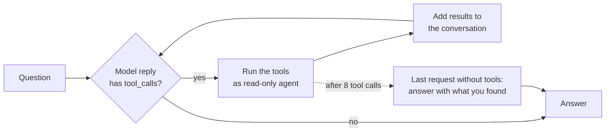
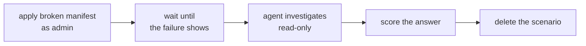

# K8s AIOps Agent

An assistant that explains problems in a Kubernetes cluster. Ask it a question in plain words, e.g. *"Why is the app in namespace aiops-lab not working?"*. It decides itself which read-only tools to call (`kubectl get / describe / logs`, events), reads the results and explains what is wrong and how to fix it.

- **Plain Python** – no LangChain or LlamaIndex; the whole agent loop is one short file, [`aiops/agent.py`](aiops/agent.py).
- **Local LLM** – `qwen3:4b-instruct` via [Ollama](https://ollama.com) with tool calling; nothing leaves the machine.
- **Read-only by design** – two layers: the code only offers fixed, checked tools, and the cluster gives the agent a ServiceAccount that can look but not change anything (and cannot read Secrets).

> **Status:** Phase 3 in progress – the agent finds the root cause in all 3 broken-cluster scenarios (15/15 runs, see [Evaluation](#evaluation)). Next: more scenarios, including a failure outside the cluster ([#3](https://github.com/Fezz00/k8s-aiops-agent/issues/3)).

## Example

A Postgres database started without a password – the reason is only in its log:

```text
$ aiops ask "The orders-db in namespace aiops-lab keeps failing. Why?"
Investigating with qwen3:4b-instruct ...
  → get_resources(kind=pods, namespace=aiops-lab)  [238 chars]
  → describe(kind=pods, name=orders-db-55848c975-5gmvn, namespace=aiops-lab)  [3090 chars]
  → get_events(namespace=aiops-lab)  [6031 chars]
  → get_logs(pod=orders-db-55848c975-5gmvn, namespace=aiops-lab, previous=True, tail=100)  [567 chars]

**Problem:** The orders-db pod is failing to start because the PostgreSQL superuser password
is not specified in the environment variables.

**Cause:** The container's startup logs show that the `POSTGRES_PASSWORD` environment variable
is missing or empty. PostgreSQL requires a password for the superuser to initialize the database.

**Evidence:** The logs show:
> Error: Database is uninitialized and superuser password is not specified.
> You must specify POSTGRES_PASSWORD to a non-empty value...

**Fix:** Add `POSTGRES_PASSWORD` to the orders-db deployment, e.g.
    env:
      - name: POSTGRES_PASSWORD
        value: "your_secure_password"

(4 tool calls, 14.5 s)
```

Every tool call is printed while the agent works (`-v` also prints the full tool output), then the answer in a fixed format: Problem, Cause, Evidence, Fix. The fix is a suggestion for you – the agent never runs it. (Answer from an eval run, slightly shortened.)

## How it works



1. **Tool menu** – the model gets the question, a system prompt and a list of tools as JSON Schema ([`registry.py`](aiops/tools/registry.py)). It picks tools from their *description* text alone.
2. **Tool call** – instead of text, the model replies with e.g. `get_logs(pod="api-55f4", namespace="study-rag", previous=true)`. The model can't run anything itself; the code does.
3. **Loop** – the result goes back into the conversation and the model is asked again, until it answers in text.
4. **Step limit** – after 8 tool calls, one last request is sent *without* tools, so a small model can't loop forever.

Errors from tools come back as text (`ERROR: pods "xyz" not found`) instead of exceptions: the model reads them and can correct itself.

### Tools

| Tool | Runs | Used for |
|---|---|---|
| `get_resources(kind, namespace?)` | `kubectl get <kind> -o wide` | Overview: status, READY, restarts |
| `describe(kind, name, namespace?)` | `kubectl describe` | Probes, limits, conditions, recent events (OOMKilled, ImagePullBackOff …) |
| `get_events(namespace?)` | `kubectl get events --sort-by=.lastTimestamp` | What happened, newest last |
| `get_logs(pod, namespace, container?, previous?, tail?)` | `kubectl logs` | `previous=true`: the log of the container that crashed. If that log is gone, the other one is returned (see [lessons](#what-the-eval-showed)) |

### Read-only in two layers

| Layer | Where | What it stops |
|---|---|---|
| **Code** | [`kubectl.py`](aiops/tools/kubectl.py) | Only 4 fixed commands; `kind` must be on an allow-list (no `secrets`); names must be valid Kubernetes names, so a "name" like `--kubeconfig=~/.kube/config` is rejected before kubectl runs; no shell; 20 s timeout; long output cut to head + tail |
| **Cluster** | [`rbac/agent-rbac.yaml`](rbac/agent-rbac.yaml) | The agent logs in as ServiceAccount `aiops-agent` with the built-in `view` role (plus read access to nodes and volumes): `delete pods` → `no`, `get secrets` → `no` |

The agent's kubeconfig holds a 24 h token and lives outside the repo (`~/.kube/aiops-agent.yaml`).

## Setup

Requires a Kubernetes cluster (developed on minikube), `kubectl`, Python 3.12 and [Ollama](https://ollama.com).

```bash
ollama pull qwen3:4b-instruct

# once, with your admin kubeconfig: namespaces aiops-agent + aiops-lab, read-only ServiceAccount
kubectl apply -f rbac/agent-rbac.yaml

# after every "minikube start" (new API port) or when the 24 h token expired
./scripts/agent-kubeconfig.sh

python3.12 -m venv .venv
source .venv/bin/activate
pip install -e ".[dev]"

aiops ask "Why is the app in namespace aiops-lab not working?"
```

Before each run, `aiops` checks that the cluster is reachable with the agent's kubeconfig and that Ollama runs with the model, and prints what to do if not.

## Evaluation

[`scenarios/`](scenarios/) holds broken workloads, each with the question for the agent and the keywords a correct answer must contain. [`eval/run_eval.py`](eval/run_eval.py) runs them against the real cluster:



Only the test harness changes the cluster (with the admin kubeconfig); the agent stays read-only even in tests. An answer passes if it names both *what* happens and *why* (at least one keyword of each group, e.g. `ImagePullBackOff` **and** `1.277`).

| # | Scenario | What is broken | Where the cause is visible | Passed |
|---|---|---|---|---|
| 01 | ImagePullBackOff | Image tag typo `nginx:1.277` | `describe` / events | **5/5** |
| 02 | CrashLoopBackOff | Postgres started without `POSTGRES_PASSWORD` | Only in the log | **5/5** |
| 03 | OOMKilled | Memory limit 32Mi, the process keeps growing | `describe`: last state `OOMKilled` | **5/5** |

`qwen3:4b-instruct`, 5 runs per scenario: 2–4 tool calls and about 13–20 s per answer, never at the step limit.

```bash
python -m eval.run_eval                  # all scenarios, 3 runs each, ~4 minutes
python -m eval.run_eval --only 02 --runs 5
```

Each run saves the full conversations in `eval/results/` (git-ignored), so a score can be checked against what the model actually saw.

### What the eval showed

- **Read the transcripts, not only the score.** The first version of scenario 02 passed 3/3, but the error check was part of the container's start command, which `describe` shows – the model read the answer there and never needed the logs. Scenario 02 now uses a real image (Postgres) whose reason is only in the log.
- **Grading mistakes count too.** One correct answer said "fails to start" and failed the "what happens" keywords (`crash`, `restart`, `exit`). `fail` now counts as well.
- **Make the tools robust instead of hoping the model copes.** For a pod in CrashLoopBackOff, `kubectl logs --previous` returned `unable to retrieve container logs` in every run – most likely because Kubernetes keeps only one dead container per pod, and that one is the "current" container. The model sometimes retried without `previous`, sometimes gave up (scenario 02: 2/3). `get_logs` now falls back to the other log by itself: 5/5.

## Configuration

All settings are environment variables ([`aiops/config.py`](aiops/config.py)).

| Variable | Default | Used for |
|---|---|---|
| `AIOPS_KUBECONFIG` | `~/.kube/aiops-agent.yaml` | The agent's read-only kubeconfig |
| `OLLAMA_URL` | `http://localhost:11434` | Ollama server |
| `CHAT_MODEL` | `qwen3:4b-instruct` | Model that drives the agent |
| `NUM_CTX` | `16384` | Context window in tokens – if the conversation is longer, Ollama silently drops the oldest part (the system prompt) |
| `MAX_STEPS` | `8` | Tool calls before the agent has to answer |
| `MAX_OUTPUT_CHARS` | `6000` | Tool output is cut to this length |
| `KUBECTL_TIMEOUT` / `LLM_TIMEOUT` | `20` / `120` | Seconds per kubectl call / model reply |

## Tests

```bash
ruff check .
pytest -v      # 50 tests, no cluster and no Ollama needed
```

kubectl and the model are replaced by fakes: the tests check the commands that are built, that bad input is rejected, the log fallback, the eval scoring, and that the loop feeds tool results back and stops at the step limit. The eval needs the cluster and Ollama, so it runs locally, not in tests.

## Known limitations

- **The 4B model misreads restart counts.** `RESTARTS 9 (25m ago)` means 9 restarts since the pod was created and the last one 25 minutes ago; the model reads it as "9 restarts in 25 minutes" and calls a healthy pod unstable – even with a rule in the system prompt that explains it. Not covered by the eval yet (it needs a "healthy namespace" scenario); likely fix: tool output written for the model instead of kubectl's compact table.
- **Keyword scoring can be fooled.** "This is not an image pull problem" still contains "pull". Good enough to compare versions; an LLM judge could replace it later.
- **The model can't be the thing that is broken.** The test app [study-RAG](https://github.com/Fezz00/study-RAG) uses the same Ollama, so "Ollama is down" can only be tested with a second Ollama instance for the agent ([#3](https://github.com/Fezz00/k8s-aiops-agent/issues/3)).

## Project structure

```text
aiops/
├── config.py          # all settings, read from environment variables
├── llm.py             # chat(messages, tools) → one request to Ollama /api/chat
├── prompts.py         # system prompt and answer format
├── agent.py           # the loop: model ↔ tools, step limit
├── cli.py             # "aiops ask", pre-checks, prints each step
└── tools/
    ├── kubectl.py     # the 4 read-only tools and their input checks
    └── registry.py    # tool menu (JSON Schema) and run_tool()
rbac/agent-rbac.yaml   # namespaces + read-only ServiceAccount
scenarios/             # broken workloads: manifest.yaml + expected.yaml (question, keywords)
eval/                  # run_eval.py (apply → ask → score → delete), scoring.py
scripts/               # agent-kubeconfig.sh
tests/                 # unit tests (pytest), with fake kubectl and fake model
```

## Roadmap

| Phase | |
|---|---|
| 0 Setup – repo, read-only ServiceAccount | ✅ |
| 1 Tools – kubectl tools with input checks | ✅ |
| 2 Agent – loop, Ollama client, CLI | ✅ |
| 3 Scenarios + eval – broken workloads in `aiops-lab`, scored automatically | 3 scenarios ✅, more next |
| 4 Prometheus – metric queries as a tool | |
| 5 CI, UI / MCP server | |
| 6 Tracing every run with Langfuse | |
